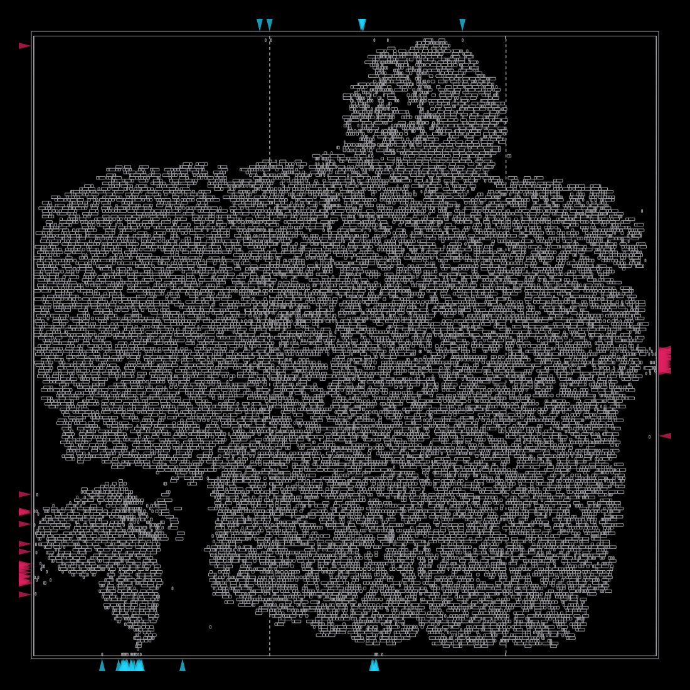
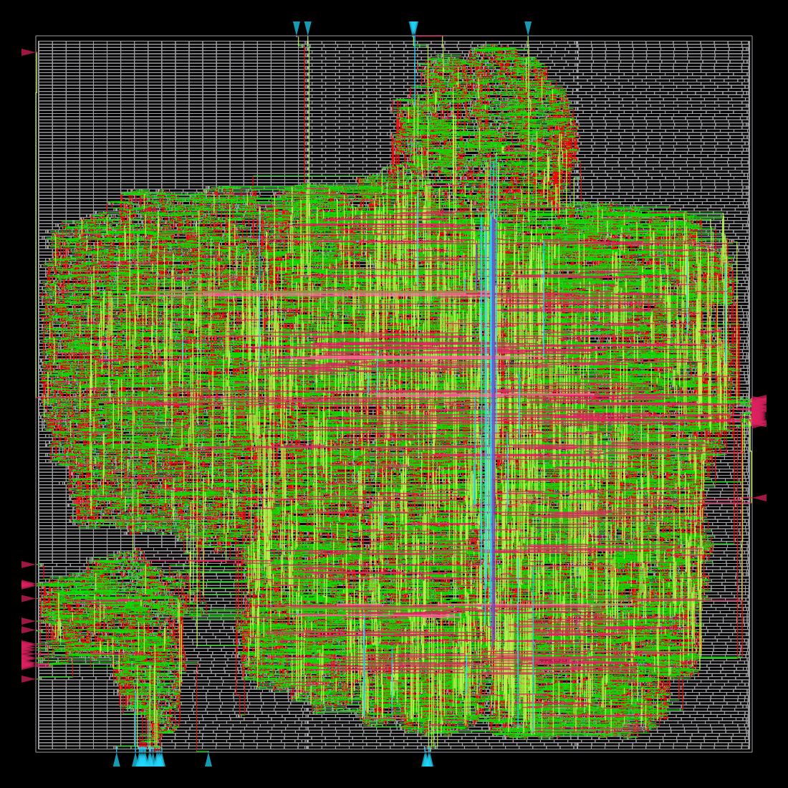
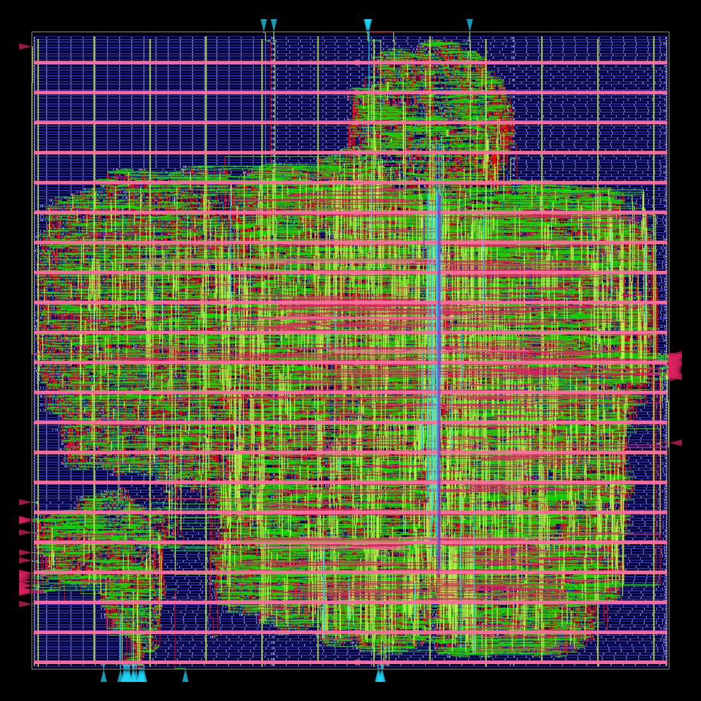
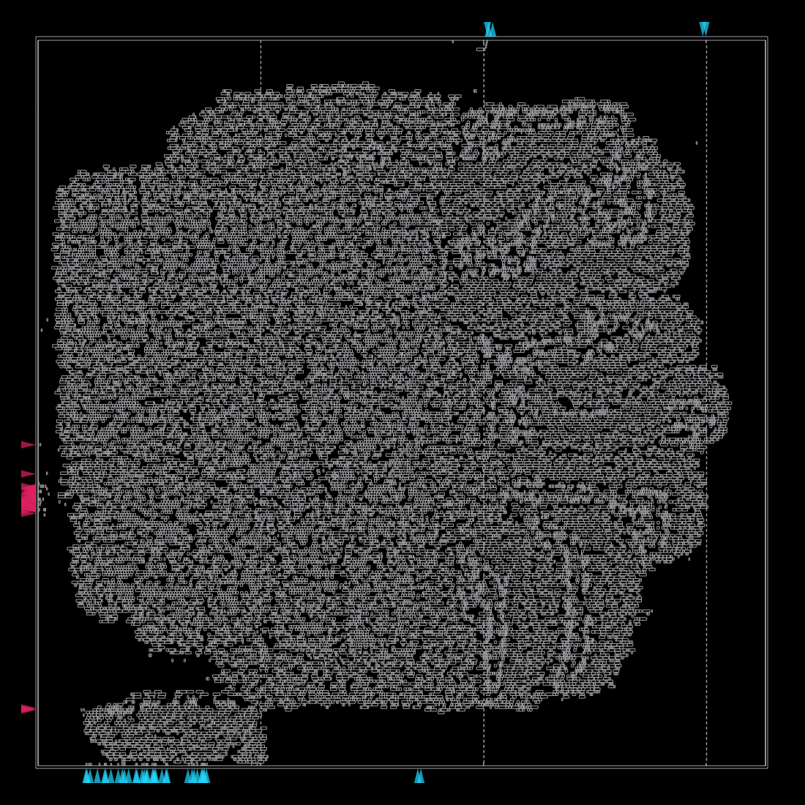
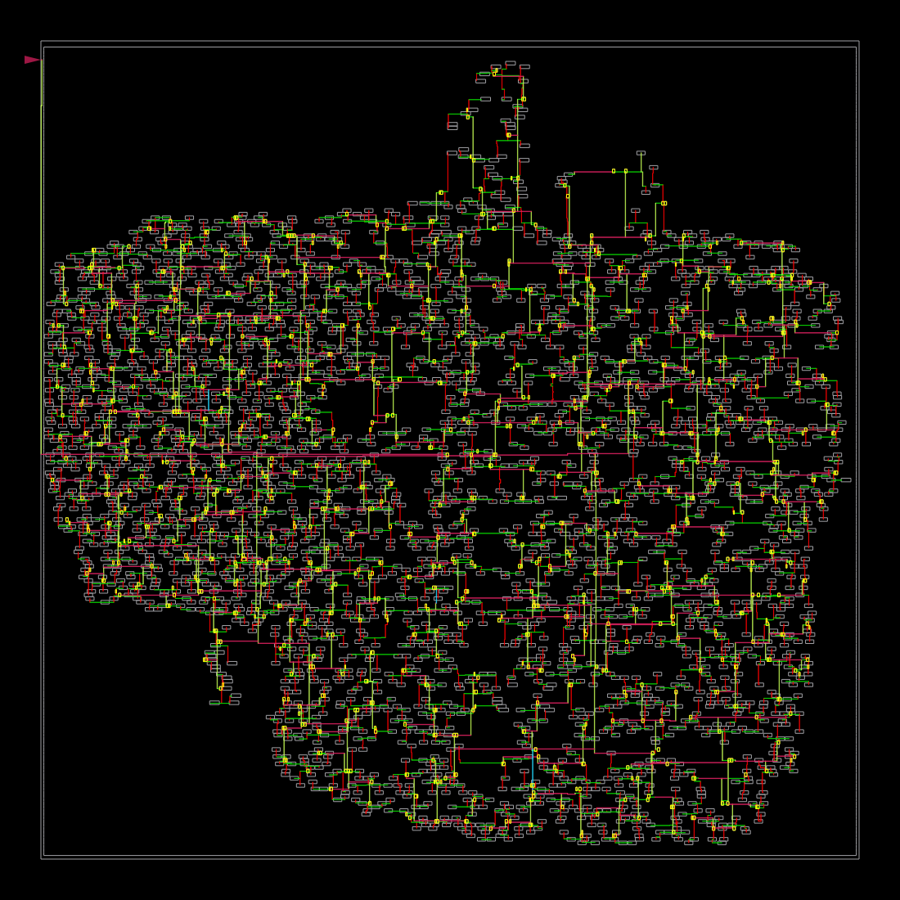
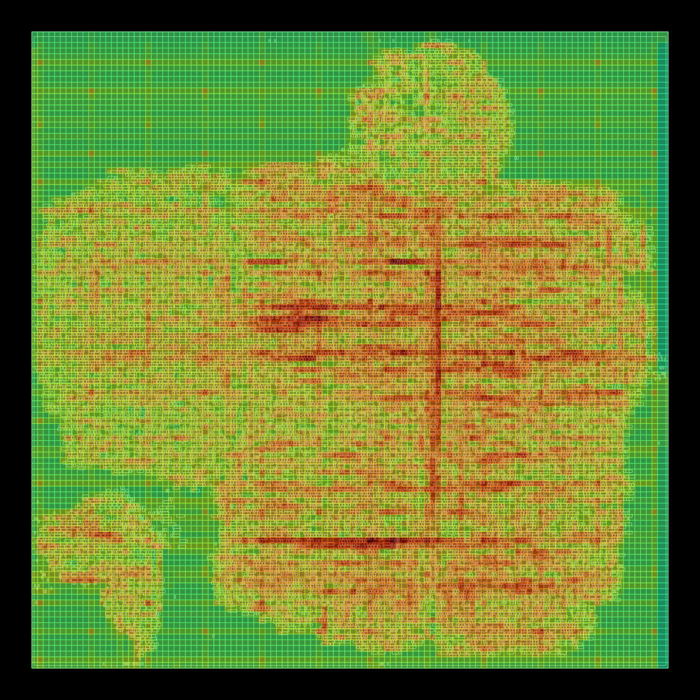

# PPA 報告（階段 E：Yosys + OpenROAD，經由 ORFS，nangate45）

比較三組：**時脈目標**（3.1）、**資料位寬**（3.3）、**架構：序列式 vs 列平行**（3.5）。

> **注意**：數字來自開源製程庫 Nangate45（FreePDK45，typical 角落），**不能直接當成實驗室製程的結果**，只能做相對比較。
> 功耗是 OpenROAD 以預設切換活動率估算，**沒有使用模擬波形**，只適合比較趨勢。

## 1. 設定

| 項目 | 設定 |
|---|---|
| 工具 | Yosys 0.69+154、OpenROAD 26Q3-2754-g9928beba28、ORFS（`~/OpenROAD-flow-scripts`） |
| 平台 | nangate45，單一時脈 `clk` |
| 設計 | `ns_top`（8x8、五輪），`ARCH=0` 序列式單一 MAC（基準）、`ARCH=1` 列平行 8 條 MAC；RTL 直接引用 `rtl/*.v` |
| 佈局參數 | `CORE_UTILIZATION = 40`、`PLACE_DENSITY = 0.60`（核心面積 99,710 µm²，實際使用率 40.6%） |
| SDC | 時脈週期可變；輸入／輸出延遲 = 週期的 20%（10 ns 時為 2 ns），見 [flow/constraint.sdc](../flow/constraint.sdc) |
| 流程 | 完整 ORFS：合成 → floorplan → 佈局 → CTS → 全域／細部繞線 → 填充 → 報表 |
| 重現 | `CLOCK_PERIOD=10 flow/run_flow.sh base`；其餘變體見 [flow/run_experiments.sh](../flow/run_experiments.sh)；彙整 `python3 flow/summarize.py` |

## 2. 結果表

「內部」指暫存器到暫存器路徑，「I/O」指輸入到輸出的組合路徑。slack ≥ 0 代表時序達標；內部最高時脈只在達標時列出（= 1 / (週期 − slack)）。

| 變體 | 資料格式 | 時脈目標 (ns) | 合成面積 (µm²) | 佈局後元件面積 (µm²) | 正反器數 | 核心面積 (µm²) | 內部（暫存器到暫存器）slack (ns) | 內部最高時脈 (MHz) | I/O 路徑 slack (ns) | 總功耗 (mW) |
|---|---|---|---|---|---|---|---|---|---|---|
| 平行 8 lane | Q3.13 / 16 位元 | 10 | 61,465.7 | 61,669.7 | 3,655 | 153,029 | 7.668 | 429 | 4.799 | 8.66 |
| 平行 8 lane、時脈 2 ns | Q3.13 / 16 位元 | 2 | 61,465.7 | 61,963.1 | 3,655 | 153,029 | 0.046 | 512 | 0.447 | 38.94 |
| 平行 8 lane、時脈 1.8 ns | Q3.13 / 16 位元 | 1.8 | 61,465.7 | 63,382.2 | 3,655 | 153,029 | -0.014 | — | 0.375 | 43.48 |
| 平行 8 lane、時脈 1.6 ns | Q3.13 / 16 位元 | 1.6 | 61,465.7 | 64,901.3 | 3,655 | 153,029 | -0.203 | — | 0.244 | 49.77 |
| 基準 | Q3.13 / 16 位元 | 10 | 40,140.2 | 40,465.5 | 3,213 | 99,710 | 8.088 | 523 | 4.978 | 7.28 |
| 時脈 2 ns | Q3.13 / 16 位元 | 2 | 40,140.2 | 40,512.3 | 3,213 | 99,710 | 0.117 | 531 | 0.515 | 33.42 |
| 時脈 1.8 ns | Q3.13 / 16 位元 | 1.8 | 40,140.2 | 40,632.3 | 3,213 | 99,710 | 0.026 | 564 | 0.359 | 37.37 |
| 時脈 1.6 ns | Q3.13 / 16 位元 | 1.6 | 40,140.2 | 41,166.4 | 3,213 | 99,710 | -0.111 | — | 0.240 | 44.36 |

收斂狀況（基準，10 ns）：細部繞線 DRC 違規 0、天線違規 0、setup／hold 皆無違規（hold slack +0.063 ns）、時脈偏移 0.027 ns。

## 3. 觀察

### 3.1 時脈目標掃描（Q3.13）

- **內部資料路徑在 1.8 ns（約 555 MHz）仍達標（slack +0.026 ns），1.6 ns 開始不達標（slack −0.111 ns）。** 關鍵路徑一貫是 MAC：運算元暫存器 `b_r` → 乘法器 → 累加器 `acc`。
- 面積幾乎不隨時脈變化（合成面積固定 40,140 µm²；佈局後 40,457～41,166 µm²，最緊的 1.6 ns 多了約 1.7% 的時序修復緩衝器）。
- 功耗大致隨頻率線性成長：7.3 mW（100 MHz）→ 37.4 mW（556 MHz），主要是動態功耗；漏電約 0.71 mW 不變。
- 一次 8x8 運算 8,527 個週期，**每次運算的能量幾乎不隨頻率變**：10 ns 時 85.3 µs × 7.28 mW ≈ 0.62 µJ，1.8 ns 時 15.4 µs × 37.4 mW ≈ 0.57 µJ。在 1.8 ns 一次運算約 15.4 µs，比 100 MHz 快 5.6 倍。

### 3.2 I/O 路徑不能代表內部速度

ORFS 預設回報的 WNS 是 **`rd_addr` → `rd_data` 的非同步讀出組合路徑**（讀出埠沒有暫存器，只有位址多工器），再加上 I/O 延遲，例如 10 ns 時 I/O 路徑 slack +4.98 ns、內部路徑 +8.09 ns。所以 ORFS 的「fmax 199 MHz」只是 I/O 約束的產物。為此我另寫 [flow/reg2reg.tcl](../flow/reg2reg.tcl)，對每個變體的最終佈局重新分析內部路徑，表中的內部欄位來自這個分析。實際使用時，讀出埠由外部取樣或加一級輸出暫存器即可消除這條路徑。

### 3.3 位寬比較

| 位寬 | 資料格式 | 合成面積 | 相對 16 位元 | 正反器 | 功耗 @10 ns | 2 ns 內部 slack | 對 float64 平均誤差（8 組隨機） | 最大誤差 | 病態（1e5）最大誤差 |
|---|---|---|---|---|---|---|---|---|---|
| 12 | Q3.9 | 30,924 µm² | 0.77× | 2,421 | 5.76 mW | +0.296 ns | 5.17e-03 | 2.32e-02 | 3.44e-01 |
| 16 | Q3.13 | 40,140 µm² | 1.00× | 3,213 | 7.28 mW | +0.117 ns | 4.17e-04 | 2.16e-03 | 5.72e-02 |
| 24 | Q3.19 | 59,655 µm² | 1.49× | 4,793 | 10.27 mW | +0.034 ns | 4.73e-05 | 4.45e-04 | 4.53e-02 |

三個位寬的 RTL 都經 `sim/run.sh --variant w12|base|w24` 驗證，與各自的位元精確模型逐位元一致；誤差欄位來自同一批模擬（階段 D 的 20 組測試向量）。

- 面積與位寬大致成**線性**（0.77× / 1× / 1.49×，位寬比為 0.75× / 1× / 1.5×），因為面積由「每個元素一個 W 位元暫存器 + 讀取多工器」主導，乘法器（隨位寬平方成長）只占很小的比例。
- 位寬越大，乘法器與加法鏈越長，2 ns 時內部 slack 由 +0.296（12 位元）降到 +0.034 ns（24 位元）。
- **16 位元是合理的折衷**：12 位元省 23% 面積，但誤差變成 10 倍（病態矩陣最大誤差 0.34，輸出奇異值嚴重偏離）；24 位元多 49% 面積，只換來更小的誤差，而 16 位元的誤差（平均 4e-4）已遠小於演算法本身與 `U@Vt` 的差距（0.4～0.8，見階段 A），沒有實質好處。

### 3.4 面積由記憶體與讀取多工器主導

合成後（基準）的單元分布：

| 類別 | 數量 | 面積 | 占比 |
|---|---|---|---|
| `MUX2_X1`（陣列讀取多工器、運算元選擇） | 8,521 | 15,900 µm² | 約 40% |
| 正反器（`DFF_X1`／`DFFR`／`DFFS`） | 3,213 | 14,600 µm² | 約 36% |
| 全加器／半加器（乘法器、累加器、位址計算） | 765 | 2,860 µm² | 約 7% |
| 其餘組合邏輯與緩衝器 | — | 約 6,800 µm² | 約 17% |

MAC 本身只占很小的比例，所以**平行化或脈動陣列**（多個 MAC）預期是用少量面積換取接近 N 倍以上的吞吐量，而縮減面積應優先針對三個暫存器陣列：A、B 只存對稱矩陣的一半、B 與 A 共用、改用 SRAM 巨集。這些都屬於後續工作，這次沒有做。

### 3.5 架構比較：序列式 vs 列平行

**列平行版（`ARCH=1`，[rtl/matmul_core_par.v](../rtl/matmul_core_par.v)）**：N = 8 條 MAC，每個命令處理整列的 8 個元素（lane j 負責第 j 個元素），所有 lane 在同一個週期處理同一個 k。數值運算與序列版完全相同，**輸出逐位元一致**（同一組 20 個測試向量、1280 個輸出元素全部通過；12／24 位元變體也各自通過）。因為整列直接算，不再利用 A 的對稱性鏡射，但整體仍快很多。

一次 8x8 運算的週期數：序列式 8,527、列平行 **1,527**（5.58 倍）。

| 時脈目標 (ns) | 架構 | 週期／次 | 內部 slack (ns) | 面積 (µm²) | 正反器 | 功耗 (mW) | 延遲 (µs／次) | 能量 (µJ／次) | 吞吐量 (次／ms) | 吞吐量／面積 (次／ms／mm²) |
|---|---|---|---|---|---|---|---|---|---|---|
| 10 | 序列式 | 8,527 | 8.088 | 40,466 | 3,213 | 7.28 | 85.27 | 0.620 | 11.7 | 290 |
| 10 | 列平行 | 1,527 | 7.668 | 61,670 | 3,655 | 8.66 | 15.27 | 0.132 | 65.5 | 1,062 |
| 2 | 序列式 | 8,527 | 0.117 | 40,512 | 3,213 | 33.42 | 17.05 | 0.570 | 58.6 | 1,447 |
| 2 | 列平行 | 1,527 | 0.046 | 61,963 | 3,655 | 38.94 | 3.05 | 0.119 | 327.4 | 5,284 |
| 1.8 | 序列式 | 8,527 | 0.026 | 40,632 | 3,213 | 37.37 | 15.35 | 0.574 | 65.2 | 1,603 |
| 1.8 | 列平行 | 1,527 | -0.014（未達標） | 63,382 | 3,655 | 43.48 | 2.75 | 0.120 | 363.8 | 5,740 |
| 1.6 | 序列式 | 8,527 | -0.111（未達標） | 41,166 | 3,213 | 44.36 | 13.64 | 0.605 | 73.3 | 1,780 |
| 1.6 | 列平行 | 1,527 | -0.203（未達標） | 64,901 | 3,655 | 49.77 | 2.44 | 0.122 | 409.3 | 6,306 |

（延遲 = 週期數 × 時脈週期；能量 = 功耗 × 延遲；吞吐量／面積以佈局後元件面積計。「未達標」代表內部 slack 為負，該列數字僅供參考。）

**各自跑到最快、時序仍達標的設定比較**（序列式 1.8 ns、列平行 2.0 ns）：

| | 序列式 @1.8 ns | 列平行 @2.0 ns | 倍率 |
|---|---|---|---|
| 延遲 | 15.35 µs | 3.05 µs | 5.0× 快 |
| 吞吐量 | 65.2 次／ms | 327.4 次／ms | 5.0× |
| 面積 | 40,632 µm² | 61,963 µm² | 1.52× |
| 吞吐量／面積 | 1,603 | 5,284 | **3.3×** |

觀察：

- **用 1.5 倍面積換 5 倍吞吐量**，吞吐量／面積提高約 3.3 倍；固定 10 ns 時脈下是 3.7 倍。列平行版的最高時脈較低（2.0 ns 達標，1.8 ns 的 slack 為 −0.014 ns），因為 8 條 MAC 共用的運算元與控制訊號扇出變大。
- **多出來的面積幾乎全是 7 條額外的 MAC**：合成後 `MUX2` 數量與面積相同（約 8,500 個、15.9k µm²，因為陣列讀取多工器沒有變多），正反器多 442 個（約 +2.3k µm²，每條 lane 的運算元與累加器暫存器），全加器／半加器多約 +10k µm²（乘法器與累加器），其餘組合邏輯多約 +9k µm²（乘法器的部分積、量化電路）。換言之每條額外 MAC 約 3k µm²。
- **每次運算的能量降為約 1/4.7**（10 ns：0.620 → 0.132 µJ）。這是因為完成同樣的工作需要的週期少很多；但功耗是預設活動率估算，序列版與平行版的實際切換活動不同，這個比值只能當作趨勢，不可當成精確值。
- 收斂：列平行版 10 ns 下 DRC 0、天線 0、hold slack +0.069 ns、setup 無違規。
- 暫存器陣列與讀取多工器的絕對面積幾乎不變（約 30k → 32k µm²），但占比從序列版的約 76% 降到列平行版的約 53%；平行化之後若還要縮面積，仍要處理陣列。中間點（例如 4 條 lane）與真正的脈動陣列沒有評估。

## 4. 版面圖

ORFS 在最終佈局上以 OpenROAD 內建繪圖輸出的影像（基準設計）：

| | |
|---|---|
| 佈局（元件分布） |  |
| 繞線（含電源網格） |  |
| 全部圖層 |  |
| 列平行版佈局 |  |
| 時脈樹 |  |
| 擁塞 |  |

這些不是 KLayout 的截圖。GDS／DEF 在 `flow/work/results/nangate45/muon_ns/<變體>/6_final.{gds,def,odb}`，要用 KLayout 或 OpenROAD GUI 檢視可執行：

```bash
klayout flow/work/results/nangate45/muon_ns/base/6_final.gds
```

## 5. 沒有做的項目與限制

- **架構比較只做了「序列式 vs 8 條 lane 列平行」**，沒有評估中間點（例如 2／4 條 lane）與脈動陣列。
- 只用一個製程角落（typical）；沒有做多角落、OCV、也沒有 sign-off 的 IR drop 分析。
- 功耗使用預設活動率，不是由 `sim/ns_top.vcd` 反標的結果。
- 各位寬的比較用相同的 SDC 與佈局參數，但 ORFS 的最佳化帶有隨機性，個位數百分比的差異不應過度解讀。
- 讀出埠為非同步組合讀取，造成 I/O 路徑（見 3.2）。
